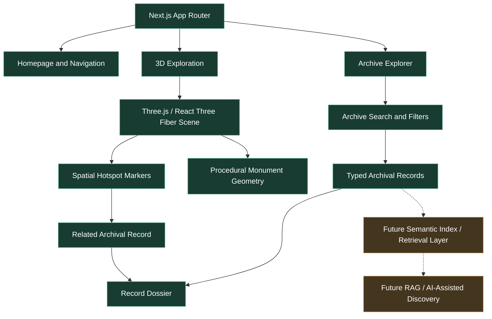
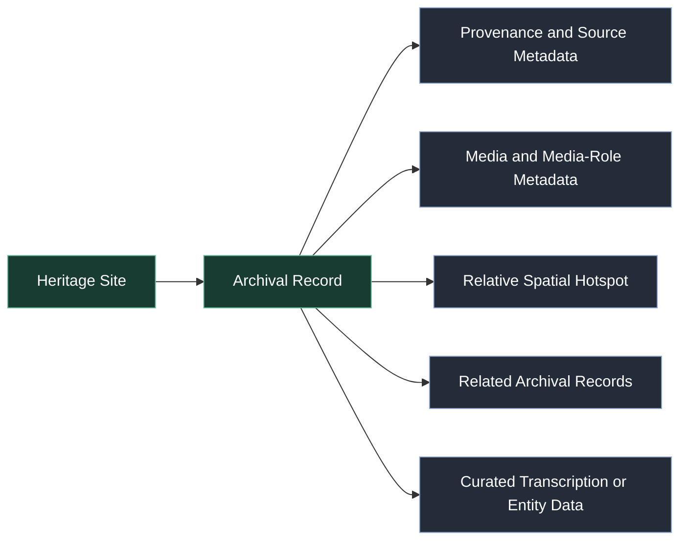

# ATEET — Reconnecting India's Heritage Through Spatial Intelligence

### An AI-Ready Immersive Digital Heritage Archive

**Focus:** Digital Revitalisation of Unstructured Cultural & Architectural Heritage Archives  
**Team:** Black Rose  
**Live demo:** <https://ateet-seven.vercel.app/>

---

## 1. The Problem: India's Heritage Is Documented, But Disconnected

India's cultural and architectural heritage is preserved across an enormous collection of historical photographs, inscriptions, archaeological surveys, architectural drawings, research publications, and institutional archives. However, these resources are often fragmented across disconnected collections. Their historical descriptions, source information, architectural context, and relationships to specific parts of monuments are not always connected.

A researcher studying a monument may need to independently locate a historical photograph, identify its source, understand the architectural feature it depicts, and connect it with other relevant documents. 
Conventional digital archives primarily organise heritage information as individual documents and images. They rarely establish an interactive relationship between archival evidence and the physical architectural spaces those records describe.

**The challenge is not merely digitising heritage documents. It is transforming fragmented historical material into interconnected, searchable, contextual, and spatially organised knowledge.**

## 2. Our Solution: ATEET

ATEET is an immersive digital heritage archive that connects structured historical records with interactive spatial exploration.

Instead of treating photographs, inscriptions, surveys, and historical publications as isolated files, ATEET organises selected heritage materials into structured archival records and connects them with corresponding locations within interactive 3D architectural visualisations.

The current prototype demonstrates this approach through two historically significant monuments in Gujarat:

- **Adalaj Stepwell**
- **Rani ki Vav**

ATEET brings together four principal capabilities:

1. **Structured archival records:** Organising heritage materials using descriptive and classification metadata.
2. **Provenance-aware documentation:** Recording source attribution, verification classifications, and media roles.
3. **Interactive spatial exploration:** Navigating procedural 3D representations of architectural levels and areas.
4. **Record-to-space connectivity:** Connecting spatial hotspots to relevant archival previews and individual dossiers.

The result is a navigable relationship between historical documentation and architectural context, supported by a structured foundation for future AI-assisted heritage discovery.

## 3. How ATEET Works

<details>
<summary><strong>Step 1 — Organise fragmented heritage materials</strong></summary>

Selected historical and contemporary materials are organised into structured records containing identifiers, descriptions, monument associations, classifications, and relevant metadata.

</details>

<details>
<summary><strong>Step 2 — Establish provenance and context</strong></summary>

Each record can contain source attribution, verification classification, media-role information, and relationships with other archival records. This helps distinguish original historical material from contextual photographs and illustrative representations.

</details>

<details>
<summary><strong>Step 3 — Explore architectural spaces</strong></summary>

Users navigate procedural 3D architectural visualisations, explore different levels and sections, and interact with spatial markers.

</details>

<details>
<summary><strong>Step 4 — Connect archival evidence with spatial locations</strong></summary>

Selecting a hotspot opens a contextual archival preview associated with that location. Users can navigate from the preview to the corresponding archival dossier.

</details>

<details>
<summary><strong>Step 5 — Build towards intelligent heritage discovery</strong></summary>

The structured archive and its relationships provide a foundation for future semantic indexing, document understanding, retrieval-augmented generation, and AI-assisted historical discovery.

</details>

## 4. Key Features

### Interactive 3D Heritage Exploration

- Explore procedural 3D visualisations of Adalaj Stepwell and Rani ki Vav.
- Navigate architectural levels and sections.
- Use camera presets and orbit-based viewing controls.
- Switch between supported monument views.

### Spatial Archival Hotspots

- Select markers positioned within the 3D environment.
- Open contextual archival previews associated with selected locations.
- Navigate from previews to corresponding archival dossiers.
- Connect selected architectural areas with relevant heritage records.

### Archival Explorer and Individual Dossiers

- Browse available heritage records.
- Search and filter records through the implemented client-side interface.
- Open individual archival record details.
- Navigate between related records.

### Provenance-Aware Metadata

Depending on the record, metadata includes:

- Record identifier, title, and description.
- Monument association and record category.
- Source attribution and provenance information.
- Verification classification.
- Media role, including contextual or illustrative media where applicable.
- Related archival record identifiers.
- Relative spatial association information.
- Curated transcription and historical-entity information where available.

## 5. Visual Showcase

The project includes a panoramic heritage visual on its landing page.


*ATEET — Exploring architectural heritage through an immersive digital experience.*

## 6. System Architecture

ATEET currently follows a modular, frontend-oriented architecture built around a statically defined archival dataset.

The application connects its archive explorer, typed archival records, procedural 3D scenes, and spatial hotspot interactions.

### Application Architecture Flowchart



*Solid connections represent implemented application flows. Dashed connections represent proposed future capabilities.*

### Current Data Flow

1. The Next.js application renders the landing page, archive routes, and exploration interface.
2. The archive module provides typed heritage-site and archival-record data.
3. The archive interface searches and filters available records on the client.
4. The 3D exploration interface renders procedural monument geometry.
5. Spatial hotspot interactions connect selected scene locations to archival previews and individual dossiers.

**Important architectural distinction:** The current release does not include a live OCR service, vector database, RAG pipeline, or LLM inference endpoint.

## 7. Technology Stack

| Layer | Technology | Purpose |
|---|---|---|
| Framework | Next.js 16 App Router | Application routing and rendering |
| UI | React 19 | Component-based interface |
| Programming Language | TypeScript | Typed application and archive data |
| 3D Rendering | Three.js | 3D scenes and procedural geometry |
| React 3D Integration | React Three Fiber | Integrating Three.js scenes with React |
| 3D Utilities | Drei | Supporting 3D controls and utilities |
| Styling | Tailwind CSS v4 | Responsive interface styling |
| CSS Processing | @tailwindcss/postcss | Tailwind CSS PostCSS integration |
| Icons | Lucide React | Interface icons |
| Deployment | Vercel | Production hosting |
| Version Control | Git and GitHub | Source-code management |

Exact installed package versions are maintained in `package.json` and `package-lock.json`.

## 8. Archive Data Model

The archive uses TypeScript types and statically defined records in the `lib/archive/` module.

Each archival record can contain several interconnected information categories:

- **Identity:** Record ID, title, and description.
- **Classification:** Monument association, category, and relevant tags.
- **Provenance:** Source details and attribution.
- **Verification:** Classification describing the nature of the supporting evidence.
- **Media Role:** Whether an image is an original depiction, contextual representation, or illustrative proxy.
- **Relationships:** Identifiers of related archival records.
- **Spatial Association:** Relative coordinates used to position a hotspot within the 3D scene.
- **Curated Content:** Transcription, translation, or named-entity metadata where supplied.

### Archival Record Relationship Diagram



This is a conceptual representation of the relationships. Actual field names and optional fields are defined in [`lib/archive/types.ts`](./lib/archive/types.ts).

## 9. Current Archive Coverage

The current prototype contains **two heritage sites and nine curated archival records**.

| Heritage Site | Archival Record IDs | Count |
|---|---|---:|
| Adalaj Stepwell | `ADL-EPI-1498`, `ADL-PHO-1874`, `ADL-SURV-BURGESS-1903`, `ADL-PHO-COLONNADE`, `ADL-PHO-OCTAGON`, `ADL-PHO-BASIN`, `ADL-PHO-ENTRANCE` | 7 |
| Rani ki Vav | `RKV-PHO-LEVEL4`, `RKV-PHO-OVERVIEW` | 2 |
| **Total** | | **9** |

Record classifications, source details, and media-role information should be read from the individual entries in [`lib/archive/data.ts`](./lib/archive/data.ts).

A contextual image is not necessarily a photograph of the specific historical object described by its associated record.

## 10. Getting Started

### Prerequisites

- Node.js compatible with the Next.js version specified in `package.json` (Node.js 20 LTS or later recommended).
- npm.

### Clone the Repository

```bash
git clone https://github.com/shreyamcoder-vibe/ATEET.git
cd ATEET
```

### Install Dependencies

```bash
npm install
```

### Start the Development Server

```bash
npm run dev
```

Open `http://localhost:3000` in your browser.

### Available Scripts

| Command | Description |
|---|---|
| `npm run dev` | Starts the development server. |
| `npm run build` | Builds the production application using the configured Next.js build command. |
| `npm run start` | Starts the production server after a successful build. |
| `npm run lint` | Runs the project's lint checks. |

## 11. Project Structure

```text
ATEET/
├── app/
│   ├── archive/
│   │   ├── [id]/
│   │   └── page.tsx
│   ├── explore/
│   │   └── page.tsx
│   ├── globals.css
│   ├── layout.tsx
│   └── page.tsx
│
├── components/
│   ├── archive/
│   └── explore/
│
├── lib/
│   └── archive/
│       ├── data.ts
│       ├── index.ts
│       └── types.ts
│
├── public/
│   └── hero-heritage-panorama.jpg
│
├── package.json
├── package-lock.json
├── postcss.config.mjs
├── next.config.ts
└── tsconfig.json
```

## 12. Data Integrity, Provenance, and Limitations

ATEET distinguishes implemented functionality from proposed capabilities. The following limitations apply to the current release:

- **Procedural 3D Visualisations:** Monument models are procedural architectural visualisations rendered with Three.js. They are not photogrammetry captures, LiDAR scans, or millimetre-accurate archaeological reconstructions.
- **Relative Spatial Coordinates:** Hotspot coordinates describe positions within the 3D visualisation. They are not verified archaeological or geodetic survey coordinates.
- **Curated Transcription:** Epigraphic transcription and translation are curated/static content, not generated by a live OCR engine.
- **Curated Entity Information:** Historical people, places, dynasties, and architectural terms are statically curated metadata, not the output of a live named-entity-recognition model.
- **Client-Side Search:** Search and filtering use client-side matching logic, not vector search or embedding-based semantic retrieval.
- **Static Archive Data:** Records are maintained in TypeScript source files. The application does not currently use a dynamic database or headless CMS.
- **No Live Generative-AI Pipeline:** The current release does not include an operational RAG pipeline, LLM integration, or AI inference API.
- **Source and Media Distinctions:** Some records use contextual or illustrative images where a direct image of the described historical object or original survey plate is unavailable. Individual record attribution and media-role metadata should be consulted.

These boundaries are intentional parts of the current prototype's scope. Provenance and media-role labels help users interpret what each record represents and how it is supported.

## 13. Future Roadmap

The following capabilities are proposed future enhancements and are **not implemented in the current release**.

### Intelligent Document Processing
- OCR for historical documents and inscriptions, including Devanagari text.
- Multilingual transcription and translation workflows.

### Historical Knowledge Extraction
- Named-entity recognition for historical people, places, dynasties, and architectural features.
- Relationship extraction across historical records.

### Semantic Discovery and AI
- Vector indexing and semantic archival search.
- Retrieval-Augmented Generation (RAG) grounded in cited archival records.
- Source-grounded AI-assisted historical explanations.

### Infrastructure and Expansion
- Database-backed archive management and editorial workflows.
- Photogrammetry- or LiDAR-derived high-fidelity 3D models.
- Expansion to additional heritage sites.
- Collaboration with archival institutions and research organisations.

## 14. Potential Impact and Scalability

ATEET demonstrates how fragmented heritage materials can be organised into a connected digital experience.

Potential areas of impact include:

- **Heritage Preservation:** Making selected archival material and architectural context easier to access.
- **Academic Research:** Helping researchers navigate between records, source information, and monument areas.
- **Education:** Providing an interactive way to explore historic water architecture.
- **Public Engagement:** Making heritage information more approachable through spatial exploration.
- **Future Knowledge Systems:** Providing structured records that could later support semantic search and AI-assisted discovery.

The current prototype demonstrates the interface, data organisation, and spatial-linking approach. Broader institutional deployment would require expanded collections, source review, data governance, and scalable storage and search infrastructure.

## 15. Team

**Team Name:** Black Rose  
**Project:** ATEET  
**Track:** Cultural & Digital Heritage

## 16. License and Attribution

### Repository License

No explicit open-source license is currently provided in this repository. Unless a license is added, the repository should not be treated as granting general permission to reuse, modify, or redistribute its code.

### Archival Sources and Media

Archival records include source and attribution metadata. Consult the individual record entries in [`lib/archive/data.ts`](./lib/archive/data.ts) for the attribution and media-role information associated with each item.

Third-party photographs and historical materials remain subject to their respective copyright, public-domain status, and Creative Commons license terms. Reuse should follow the original source's terms and attribution requirements.

----------------------------------------------------------------------------------------------------
