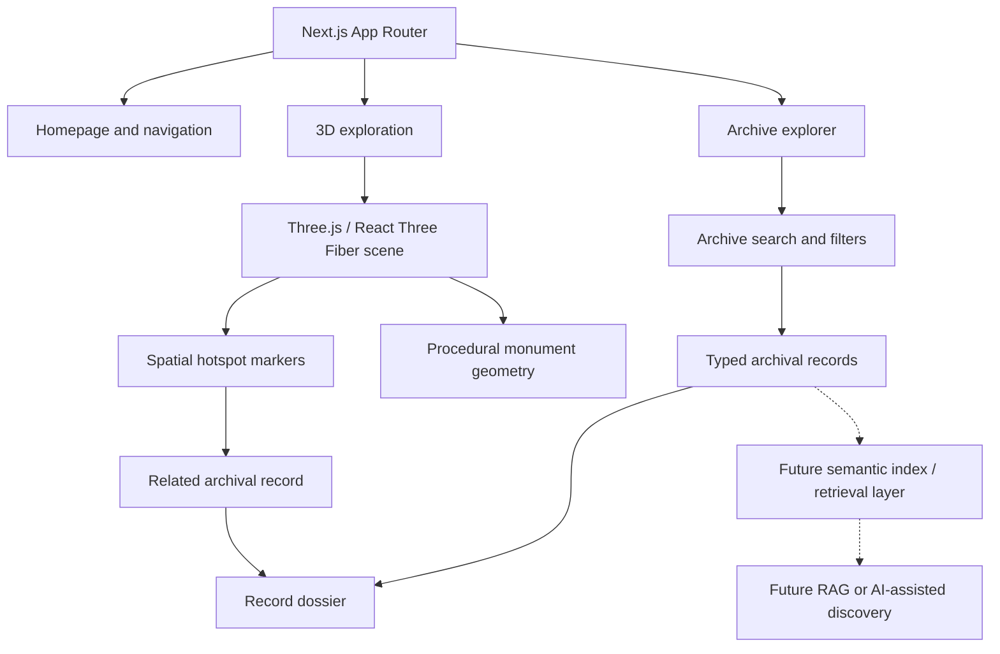
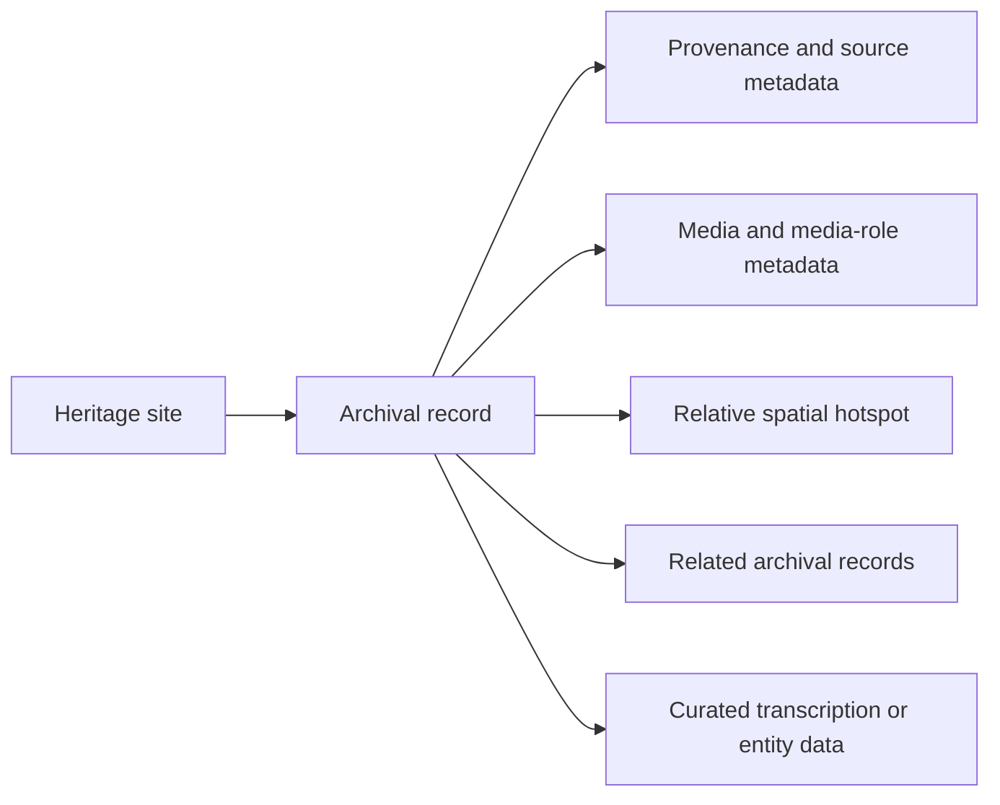

# ATEET --- An AI-Ready Immersive Digital Heritage Archive

**Hackathon:** HackCult '26 --- IIT Gandhinagar\
**Problem statement:** HC26-CULT01 --- Digital Revitalisation of
Unstructured Cultural & Architectural Heritage Archives\
**Team:** Black Rose\
**Live demo:** <https://ateet-seven.vercel.app/>\
**Repository:** <https://github.com/shreyamcoder-vibe/ATEET>

------------------------------------------------------------------------

## 1. Project Overview

Cultural and architectural heritage information is often distributed
across photographs, inscriptions, historical publications,
archaeological surveys, and institutional collections. These materials
can be difficult to explore together because their descriptions,
sources, and relationships to specific parts of a monument are not
always connected.

**ATEET** is an immersive digital heritage archive that links structured
archival records with interactive spatial exploration. It brings
together monument information, provenance-labelled records, curated
historical context, and procedural 3D architectural visualisations in
one interface.

The current prototype focuses on two heritage sites in Gujarat:

-   **Adalaj Stepwell**
-   **Rani ki Vav**

ATEET is designed as an **AI-ready foundation**: its structured records
and relationships can support future semantic discovery and retrieval
systems. The current release does not claim to run live OCR, NLP, or
generative-AI inference.

## 2. Problem Statement

**HC26-CULT01 --- Cultural & Architectural Heritage Archives**

Heritage documentation may be fragmented across historical photographs,
inscriptions and epigraphic publications, archaeological surveys,
architectural descriptions, and contemporary documentation. When these
resources are treated as disconnected files, users have to manually
connect a source to the monument, architectural feature, historical
context, and other relevant records.

ATEET addresses this problem by organising selected heritage materials
into structured records and connecting those records to locations within
an interactive, relative 3D representation of each monument.

## 3. Our Solution

ATEET combines four principal elements:

1.  **Structured archival records** --- descriptive and classification
    metadata are organised alongside each record.
2.  **Provenance-aware documentation** --- source attribution,
    verification classification, and media role help users understand
    the nature of each item.
3.  **Spatial exploration** --- procedural 3D visualisations provide an
    interactive way to explore architectural levels and areas.
4.  **Record-to-space connections** --- spatial hotspots connect
    selected areas in the viewer to relevant archival records and
    dossiers.

This creates a navigable relationship between archival evidence and
architectural context while establishing a structured foundation for
future AI-assisted heritage discovery.

## 4. Key Features

### Interactive 3D heritage exploration

-   Explore procedural 3D visualisations of Adalaj Stepwell and Rani ki
    Vav.
-   Navigate architectural levels and sections.
-   Use camera presets and orbit-based viewing controls.
-   Switch between the supported monument views.

### Spatial archival hotspots

-   Select markers positioned within the 3D scene.
-   Open a contextual archival preview associated with a hotspot.
-   Navigate from a preview to the corresponding archival dossier.

### Archival explorer and dossiers

-   Browse the available heritage records.
-   Search and filter records using the implemented client-side
    interface.
-   Open individual record details.
-   Follow links between related records.

### Provenance-aware metadata

Depending on the record, metadata includes: - Record identifier, title,
and description. - Monument association and record category. - Source
attribution and provenance information. - Verification classification. -
Media role, including contextual or illustrative media where
applicable. - Related record identifiers. - Spatial association
information. - Curated transcription and historical-entity information
where available.

## 5. Visual Showcase

The project includes a panoramic heritage image on the landing page:


For the latest interactive experience, visit the [live ATEET
platform](https://ateet-seven.vercel.app/).

*Additional screenshots of the homepage, archive explorer, archival
dossier, and 3D viewer can be added here.*

## 6. System Architecture

The current application is a web-based frontend with a statically
defined archival dataset. The 3D viewer renders procedural geometry and
connects selected spatial markers to the archival records.



### Current data flow

1.  The Next.js application renders the landing page and the archive and
    exploration routes.
2.  The archive module provides typed heritage-site and archival-record
    data.
3.  The archive interface searches and filters the available records on
    the client.
4.  The 3D exploration interface renders procedural monument geometry.
5.  Spatial hotspot interactions connect selected scene locations to
    archival record previews and dossiers.

The solid connections represent the current application flow. The dashed
connection represents possible future work. A live OCR service, vector
database, RAG pipeline, or LLM inference endpoint is **not** part of the
current release.

## 7. Technology Stack

Exact installed versions are recorded in `package.json` and
`package-lock.json`.

  ------------------------------------------------------------------------
  Layer                   Technology               Purpose
  ----------------------- ------------------------ -----------------------
  Framework               Next.js App Router       Application routing and
                                                   rendering

  UI                      React                    Component-based user
                                                   interface

  Language                TypeScript               Typed application and
                                                   archive data

  3D rendering            Three.js                 3D scene and procedural
                                                   geometry

  React 3D integration    React Three Fiber        Three.js scene
                                                   integration with React

  3D helpers              Drei                     Supporting 3D controls
                                                   and utilities where
                                                   used

  Styling                 Tailwind CSS             Responsive interface
                                                   styling

  CSS processing          `@tailwindcss/postcss`   Tailwind CSS v4 PostCSS
                                                   integration

  Deployment              Vercel                   Hosted production
                                                   deployment
  ------------------------------------------------------------------------

## 8. Archive Data Model

The archive uses TypeScript types and statically defined records in the
`lib/archive/` module.

Depending on the record, the data model covers:

-   **Identity:** record ID, title, and description.
-   **Classification:** monument, category, and relevant tags.
-   **Provenance:** source details and attribution.
-   **Verification:** a classification describing the nature of the
    supporting evidence.
-   **Media role:** whether an image is an original depiction, a
    contextual representation, or an illustrative proxy.
-   **Relationships:** identifiers of related archival records.
-   **Spatial association:** relative coordinates used to position a
    hotspot in the 3D scene.
-   **Curated content:** transcription, translation, or named-entity
    metadata where supplied.



This is a conceptual view of the relationships; the actual field names
and optional fields are defined in
[`lib/archive/types.ts`](./lib/archive/types.ts).

## 9. Current Archive Coverage

The current project audit identifies **two heritage sites and nine
archival records**. The records are statically curated in the project
source.

  -----------------------------------------------------------------------
  Heritage site                       Record IDs
  ----------------------------------- -----------------------------------
  Adalaj Stepwell                     `ADL-EPI-1498`, `ADL-PHO-1874`,
                                      `ADL-SURV-BURGESS-1903`,
                                      `ADL-PHO-COLONNADE`,
                                      `ADL-PHO-OCTAGON`, `ADL-PHO-BASIN`,
                                      `ADL-PHO-ENTRANCE`

  Rani ki Vav                         `RKV-PHO-LEVEL4`,
                                      `RKV-PHO-OVERVIEW`
  -----------------------------------------------------------------------

Record classifications and source details should be read from the
individual records in [`lib/archive/data.ts`](./lib/archive/data.ts). A
contextual image is not necessarily a photograph of the specific
archival object described by the record.

## 10. Getting Started

### Prerequisites

-   Node.js compatible with the Next.js version specified in
    `package.json` (Node.js 20 LTS or later is recommended).
-   npm.

### Clone the repository

``` bash
git clone https://github.com/shreyamcoder-vibe/ATEET.git
cd ATEET
```

### Install dependencies

``` bash
npm install
```

### Start the development server

``` bash
npm run dev
```

Open <http://localhost:3000> in your browser.

### Available scripts

  -----------------------------------------------------------------------
  Command                             Description
  ----------------------------------- -----------------------------------
  `npm run dev`                       Starts the local development
                                      server.

  `npm run build`                     Builds the production application
                                      using the configured Next.js build
                                      command.

  `npm run start`                     Starts the production server after
                                      a successful build.

  `npm run lint`                      Runs the project's lint checks.
  -----------------------------------------------------------------------

## 11. Project Structure

``` text
ATEET/
├── app/
│   ├── archive/
│   │   ├── [id]/
│   │   └── page.tsx
│   ├── explore/
│   │   └── page.tsx
│   ├── globals.css
│   ├── layout.tsx
│   └── page.tsx
├── components/
│   ├── archive/
│   └── explore/
├── lib/
│   └── archive/
│       ├── data.ts
│       ├── index.ts
│       └── types.ts
├── public/
│   └── hero-heritage-panorama.jpg
├── package.json
├── package-lock.json
├── postcss.config.mjs
├── next.config.ts
└── tsconfig.json
```

## 12. Data Integrity, Provenance, and Limitations

ATEET distinguishes implemented functionality from planned capabilities.
The following limitations apply to the current release:

-   **Procedural 3D visualisations:** The monument models are procedural
    architectural visualisations rendered with Three.js. They are not
    photogrammetry captures, LiDAR scans, or millimetre-accurate
    archaeological reconstructions.
-   **Relative spatial coordinates:** Hotspot coordinates describe
    positions within the 3D visualisation. They are not verified
    archaeological or geodetic survey coordinates.
-   **Curated transcription:** Epigraphic transcription and translation
    included in the archive are curated/static content. They are not
    generated by a live OCR engine.
-   **Curated entity information:** Historical people, places,
    dynasties, and architectural terms are statically curated metadata,
    not the output of a live named-entity-recognition model.
-   **Client-side search:** Search and filtering use the application's
    current client-side matching logic. They are not vector search or
    embedding-based semantic retrieval.
-   **Static archive data:** The current records are maintained in
    TypeScript source files. The application does not currently use a
    dynamic database or headless CMS.
-   **No live generative-AI pipeline:** The current release does not
    include an operational RAG pipeline, LLM integration, or AI
    inference API.
-   **Source and media distinctions:** Some records use contextual or
    illustrative images where a direct image of the described historical
    object or original survey plate is not available in the current
    collection. Consult each record's attribution and media-role
    metadata.

These boundaries are intentional parts of the current prototype's scope.
Provenance and media-role labels help users interpret what each record
represents and how it is supported.

## 13. Future Roadmap

The following are proposed future enhancements and are **not implemented
in the current release**:

-   OCR for historical documents and inscriptions, including Devanagari
    text.
-   Multilingual transcription and translation workflows.
-   Named-entity recognition for historical people, places, dynasties,
    and architectural features.
-   Vector indexing and semantic archival search.
-   Retrieval-Augmented Generation (RAG) grounded in cited archival
    records.
-   Database-backed archive management and editorial workflows.
-   Photogrammetry- or LiDAR-derived high-fidelity 3D models.
-   Expansion to additional heritage sites and collaboration with
    archival institutions.

## 14. Potential Impact and Scalability

ATEET demonstrates how fragmented heritage materials can be organised
into a connected digital experience.

Potential areas of value include:

-   **Heritage preservation:** making selected archival material and
    architectural context easier to access.
-   **Research:** helping users navigate between records, source
    information, and monument areas.
-   **Education:** providing an interactive way to explore historic
    water architecture.
-   **Public engagement:** making heritage information more approachable
    through spatial exploration.
-   **Future knowledge systems:** providing structured records that
    could later support semantic search and AI-assisted discovery.

The current prototype demonstrates the interface, data organisation, and
spatial-linking approach. Broader institutional deployment would require
expanded collections, source review, data governance, and scalable
storage and search infrastructure.

## 15. Team

**Team name:** Black Rose\
**Event:** HackCult '26 --- IIT Gandhinagar\
**Problem statement:** HC26-CULT01 --- Cultural & Architectural Heritage
Archives

## 16. License and Attribution

### Repository license

No explicit open-source license is currently provided in this
repository. Unless a license is added, the repository should not be
treated as granting general permission to reuse, modify, or redistribute
its code.

### Archival sources and media

Archival records include source and attribution metadata. Consult the
individual record entries in
[`lib/archive/data.ts`](./lib/archive/data.ts) for the attribution and
media-role information associated with each item.

Third-party photographs and historical materials remain subject to their
respective copyright, public-domain status, and Creative Commons license
terms. Reuse should follow the original source's terms and attribution
requirements.

------------------------------------------------------------------------

**Explore ATEET:** <https://ateet-seven.vercel.app/>
